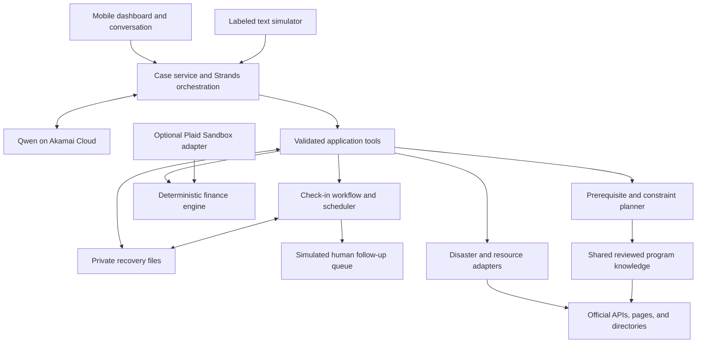

# StillHere — MVP Project Specification

Status: consolidated product specification for implementation handoff.

Date: October 10, 2026. Build timebox: 12 hours of dedicated prototyping with coding agents.

This document is the authoritative high-level specification. It consolidates discovery, recovery finance, and the accepted check-in approach. Product scope and behavior are defined here; implementation sessions select concrete infrastructure, frameworks, model configuration, and provider setup. P1 has implemented the C01 private case-service and intake-persistence foundation; the full application and deployment remain pending. Current implementation evidence is recorded in the component tracker.

Accepted follow-up scope: optional scheduled check-ins, optional last-shared location, and a simulated human follow-up queue. The [monitoring design](monitoring-design.md) and [partner research](response-partner-discovery.md) are supporting background. Detailed local partner discovery and live response operations belong to a later pilot; they do not block this MVP plan.

Implementation coordination is recorded in [Component Contracts and Progress](contracts-and-progress.md): the two-person ownership split, shared input/output boundaries, mocks, and component/milestone status. This specification remains authoritative for product scope.

## 1. Purpose and goals

StillHere helps people affected by U.S. crises who have lost access to housing, documents, money, transportation, connectivity, or support:

1. **Survive the immediate situation:** reach actionable emergency and essential-service resources.
2. **Recover through feasible steps:** replace documents and pursue assistance despite missing prerequisites and changing circumstances.
3. **Manage money through recovery:** understand accessible resources, upcoming essential expenses, uncertain aid, and the financial consequences of recovery actions.

The primary experience is for a survivor or someone helping that household. A small simulated operator queue demonstrates follow-up accountability; a full caseworker console is future scope. The MVP demonstrates one complete household journey while supporting nationwide referral routing across floods, storms/hurricanes, wildfires, and earthquakes. It is a prototype, not a public operating service with comprehensive national policy coverage or staffed support.

The agent creates and maintains a persistent private **recovery file** through tools. The dashboard displays that file. Conversation and direct controls update the same records, so the household can choose whichever interaction is easiest.

The fintech feature asks whether the household can cover essentials while carrying out its recovery plan. That question supports the broader three-part purpose; financial optimization does not replace urgent help or recovery guidance.

Optional check-ins support continuity for returning households: record their last explicit report, next agreed contact, unresolved follow-up, and who has acknowledged responsibility in the demonstration workflow.

## 2. Scope decisions

The user agreed to the overall prototype direction and financial concept. The following defaults resolve remaining routine scope choices so implementing agents can proceed without reopening product discovery.

| Area | MVP decision |
| --- | --- |
| Agent stack | Strands Agents SDK; Qwen inference on Akamai Cloud. One coordinating runtime agent. |
| Backend | Agent-led orchestration with validated application tools and durable household state. |
| Geography | Nationwide U.S. guidance and official referral routing; detailed program rules are bounded and explicitly scoped. |
| Crises | Floods, storms/hurricanes, wildfires, and earthquakes; other/unknown events receive general help and relevant official referrals. |
| First use | Short general selections, followed by adaptive conversation and an evolving dashboard. |
| Recovery support | Essentials, document replacement, aid applications, and near-term recovery actions. |
| Agent authority | Search, ask questions, maintain the case, prepare answers/call scripts, and propose plans. Users control external submissions and commitments. |
| Finance | Manual balances, expenses, aid tracking, support coverage, deterministic 14-day forecasts, scenarios, and action-cost comparison. |
| Fintech API | Plaid Sandbox is an optional read-only stretch integration. No Flex API is required. |
| Connectivity | Cached/saved plan, offline task and manual-money changes, printable summary, and a labeled text-channel simulator. |
| Documents | Track available/missing evidence and prepare answers; raw document uploads, OCR, and a document vault are deferred. |
| Knowledge sharing | Source-backed versioned program rules are shared; household facts and financial records remain private. |
| Refresh | Reassess on user changes and return; process agreed check-in due times independently of chat. |
| Check-ins | Opt-in next check-in time, explicit replies, simulated reminders, overdue status, and human-reviewed follow-up in a demo queue. |
| Location sharing | Optional user-entered place or one-time permission-based location, labeled with its timestamp. Continuous background tracking is deferred. |
| Language/access | Plain English prototype; mobile, keyboard, and screen-reader access; skips, corrections, and clear uncertainty states. |

Live SMS can replace the simulator only if an already usable provider/sender is validated during implementation. Live delivery is not a completion dependency. No first-time access with zero internet and zero cellular connectivity is promised; that needs physical or assisted distribution.

Welfare reminders, calls, and human follow-up remain simulated in this MVP even if a live conversational SMS channel is available. StillHere has no committed response team. Real welfare outreach and field response require a separately scoped pilot with staffed partners.

## 3. User journey

### 3.1 Initial selections

Offer these short groups before chat. Permit skipping, uncertainty, and an urgent-help bypass. Do not require names, identity numbers, bank connections, or document uploads.

| Prompt | Choices / input |
| --- | --- |
| What kind of help do you need right now? | Urgent safety help; essentials for today; recovery steps; unsure |
| What happened? | Flood; storm/hurricane; wildfire; earthquake; another crisis; unsure |
| What would help most? | Shelter; food/water; health support; transport; lost documents; aid applications; managing money; unsure. Multiple selection. |
| Who needs support? | Just me; children with me; other adults with me; helping someone else. Clarify combinations later. |

Request an optional city/ZIP or permission-based location when local discovery needs it. Distinguish current location from damaged residence and the jurisdiction that issued a lost document. A skipped answer remains unknown; an unselected need is not evidence that it is absent.

### 3.2 Conversation and initial help

The agent reads the selections, creates a partial recovery file, and asks the next useful question. It begins resource discovery as soon as sufficient context exists. A complete profile is not a prerequisite for help.

Ask about current safety and the most urgent need first when relevant. Present official emergency directions and a clear route to appropriate emergency services when indicated. Then progressively learn constraints such as transport, dependents, communication access, documents, and accessible money. Prefer one or two focused questions per turn; offer simple choices when they fit.

The first useful result is an actionable resource or next step with a source, contact/destination, known requirements, and a visible availability state. A listing does not imply acceptance, current capacity, or a reservation.

### 3.3 Adaptive planning

Each action includes its purpose, requirements, deadline if known, cost if known, execution mode, status, and a fallback or unresolved blocker. Show a few prioritized next steps while retaining the longer plan.

Example: the household reports no car after receiving an office-visit suggestion. The agent updates mobility, identifies affected actions, investigates source-supported remote procedures, transit, mobile assistance, or transport support, and revises those steps. It preserves completed work and unaffected tasks.

Users can mark a task done, report that they cannot do it, correct a fact, update aid status, or enter spending directly. Those changes have the same effect as equivalent chat updates. Returning users resume the case rather than repeat intake.

### 3.4 Application preparation

Provide official application links, required-fact checklists, draft answers, and call scripts. Distinguish what is needed to begin an application from evidence that may be supplied later. Unknown facts stay unfilled. The household reviews prepared content and performs external submission.

Track application status as user-reported or provider-supported. Internal task completion does not establish that an agency received a form, approved aid, booked an appointment, or accepted the household.

### 3.5 Optional check-ins

After immediate needs are addressed, offer follow-up enrollment. The user chooses the next check-in time, contact preference, and grace period, and can decline, pause, or reschedule. Present replies: **I'm okay for now**, **I need help**, and **Check later**; the last option asks for a new time. An explicit help request immediately shows appropriate official help and enters the simulated review queue without waiting for the timer.

Nonresponse after the agreed grace period marks the check-in overdue and the household's condition unknown. A missed login alone does not trigger this workflow. No universal 24/48-hour escalation or automatic field visit is used.

Location sharing is separately optional. Show the last shared place, when it was provided, and who may access it. Users can update or remove it and stop sharing. A damaged residence, old coordinate, or phone position is not a verified current destination or evidence of the person's condition.

## 4. Living recovery file

The file is a logical case record; it need not be one physical file. Store these categories progressively:

| Record | Contents |
| --- | --- |
| Circumstances | Locations, household composition, priorities, mobility, communication/access needs, and relevant constraints |
| Needs | Urgency, covered/uncovered status, and unresolved questions |
| Evidence | Available/missing documents, accepted alternatives, issuing jurisdiction, and supporting sources |
| Recovery actions | Requirements, costs, deadlines, alternatives, status, and reason for selection |
| Applications | Program, stage, outstanding evidence, reported correspondence, and next action |
| Financial records | Accessible money, actual events, planned expenses, aid, support coverage, and scenarios |
| Check-ins and follow-up | Enrollment/consent, next due time and grace period, last explicit report, simulated contact attempts, follow-up status, acknowledged owner, outcome, and next action |
| Shared location | Optional place/coordinates, observation time, source/accuracy where available, and permitted purpose/access; distinct from damaged residence |
| Resources and sources | Contacts, destinations, geographic scope, evidence, availability, and freshness |
| History | Fact changes, corrections, plan versions, completed work, and reasons for revisions |

Facts carry provenance and timestamps. Distinguish unknown, user-reported, source-supported, conflicting, and no-longer-current information. Sensitive facts are collected only when needed and volunteered.

Keep app activity, check-in reports, message-delivery state, and follow-up ownership separate. A login or delivered message does not count as an explicit welfare reply.

All tools and direct controls act within a household's authorization scope. Apply stable event IDs and case versions so retries do not duplicate entries and concurrent updates do not silently overwrite a correction. Implementation agents freeze executable schemas from the [contract baseline](contracts-and-progress.md) before parallel work begins.

## 5. High-level architecture



Use a modular application with durable transactional storage and explicit internal interfaces. A graph database, microservice fleet, or multiple autonomous runtime agents is not required. Preserve graph semantics in the rule representation; later evidence can justify a storage change.

### Responsibility boundaries

- **Strands/Qwen:** choose follow-up questions, retrieve context through tools, propose feasible alternatives, explain results, and request structured case/dashboard updates.
- **Case service:** authorization, persistence, versioning, event processing, corrections, and synchronization.
- **Source adapters:** retrieve and normalize external information, retain attribution, and report freshness/errors.
- **Knowledge/planner:** enforce published prerequisites, geographic scope, timing, constraints, alternatives, and plan status.
- **Finance service:** validate financial events, reconcile records, apply restrictions, and calculate forecasts/scenarios.
- **Check-in workflow:** enforce consent, schedules, due/overdue transitions, simulated attempts, and acknowledged follow-up ownership independently of model reasoning.
- **Dashboard:** render approved component schemas and return structured user actions; provide separate scoped demo operator controls for the follow-up queue.

The model does not calculate authoritative money, write arbitrary database content, publish policy by itself, execute generated dashboard code, or dispatch responders. Application tools enforce these boundaries independently of model text. Check-in enrollment and information-sharing permission require explicit user action; the model cannot infer consent.

### Conceptual tool contract

| Tool capability | Expected result |
| --- | --- |
| Read/create/update case | Durable scoped facts, needs, questions, and corrections |
| Get incident context | Source-attributed alerts/declarations/events with geographic relevance and freshness |
| Find resources | Relevant service candidates with contacts, coverage, known requirements, and availability state |
| Retrieve program rules | Published scoped requirements and official references, or explicit unknown/conflicting results |
| Evaluate/revise plan | Validated actions, blockers, alternatives, and reasons; preserve completed work |
| Prepare application content | Draft answers/checklists/scripts with unknowns and evidence references |
| Record financial update | Validated, idempotent event or a proposed entry requiring clarification |
| Calculate/compare finances | Reproducible baseline/scenarios with dates, gaps, and assumptions |
| Schedule/pause a check-in | User-confirmed due time/preferences or stopped schedule |
| Record a check-in/help request | Timestamped user report, revised next contact, and simulated review request where needed |
| Review/update follow-up | Scoped demo operator acknowledgment, contact attempt, outcome, and next action; no external dispatch |
| Publish dashboard components | Allowed components derived from persisted case and computed results |

Every response distinguishes successful data retrieval, no matching data, unknown facts, stale data, and provider failure. A failed lookup must not be interpreted as proof that a resource or disaster does not exist.

## 6. Disaster and resource information

No single feed supplies hazards, assistance declarations, service directories, and confirmed local capacity. Use separate adapters behind the same tools. An MCP wrapper is optional; reliable documented APIs are sufficient.

| Source | Role and implementation requirement |
| --- | --- |
| National Weather Service | Active geographic weather alerts and official instructions. Implement and demonstrate a live request; retain source update/expiry information. [API documentation](https://www.weather.gov/documentation/services-web-api). |
| USGS | Earthquake event context. Implement a relevant feed/catalog adapter with explicit failure behavior. An event is not an eligibility decision. [Feeds](https://earthquake.usgs.gov/earthquakes/feed/v1.0/), [catalog](https://earthquake.usgs.gov/fdsnws/event/1/1). |
| OpenFEMA | Disaster declarations and designated assistance context. Validate the current declaration schema before matching program/area flags. A declaration is not a live hazard feed or household approval. [Federal catalog](https://catalog.data.gov/dataset/disaster-declarations-summaries). |
| 211 | Candidate community-service directory integration if access is available. Validate permission, coverage, and permitted storage; do not make credentials a core dependency. [Developer portal](https://apiportal.211.org/). |
| Red Cross and local official pages | Shelter/referral information. Use documented or permitted access and direct official links; show unknown capacity. Do not assume the public locator provides a supported API. [Shelter locator](https://www.redcross.org/get-help/disaster-relief-and-recovery-services/find-an-open-shelter.html?lv=true). |
| USAGov and relevant issuing/program authorities | National routing to document replacement and assistance, followed by jurisdiction-specific official requirements. [Document replacement](https://www.usa.gov/replace-vital-documents), [disaster assistance](https://www.usa.gov/disaster-financial-help). |

The source agent produces a bounded reviewed catalog covering urgent shelter/food/transport referrals, document replacement, and disaster assistance. Select one clearly labeled demonstration jurisdiction with enough verified detail to exercise prerequisites and a real alternative path. Record that choice in the implementation README. Elsewhere, retrieve relevant official material or provide an official referral with visible limits; do not invent detailed national coverage.

Weather alerts alone do not establish every active wildfire or every affected area. Use the user's account alongside available official context, label mismatches or missing feeds, and route to relevant local authorities. No matching federal declaration does not eliminate local/nonfederal support.

Store source URL, issuer, geographic scope, retrieval time, source update/effective time where known, verification state, and availability state. Adapters define freshness/expiry behavior. A retrieved page timestamp does not establish live shelter capacity. Label all seeded incident/resource fixtures as demonstrations.

## 7. Dynamic prerequisites and shared knowledge

Maintain three separate stores: published public program knowledge; private household facts/plans; and candidate rule changes/discrepancy reports awaiting review.

### Rule model

Represent programs, actions, proofs, required facts, providers, and outcomes with typed relationships and requirement expressions:

- `all_of` for conjunctive prerequisites and `any_of` for acceptable alternatives.
- Conditional requirements tied to relevant circumstances.
- Timing: required to start, required later, or required before receiving assistance.
- Scope: jurisdiction, issuing authority, program/incident version, and effective dates.
- Evidence state: satisfied, missing, unknown, conflicting, or not applicable.

Each published rule has an authoritative reference, supporting section, review state, and version. Model confidence is not policy verification. Preserve distinctions between identity, residence, ownership, household facts, and application evidence rather than treating one document as proof of everything.

### Planning policy

Prioritize safety and essential needs, then feasibility and deadlines, then the user's preferences about money, travel, time, and effort. Compare a bounded set of relevant alternatives. Do not optimize only for shortest graph path or maximum possible payout.

Detect circular requirements and seek source-supported alternative proofs or authorized processes. If no verified route exists, expose the blocker and an appropriate official contact/referral. Unknown requirements produce provisional steps or questions, not claims that the household can complete them. Run independent actions in parallel when appropriate.

### Efficient evolution across users

Retrieve published rules by program, incident, jurisdiction, and version before fetching new material. Prefer structured official APIs, then official pages/form instructions. Cache permitted public information and deduplicate retrieval. Search/fetch relevant missing material on demand rather than crawling government sites on every turn.

New material creates candidate rules: extract, validate, compare with the published version, review, then publish. User reports can flag discrepancies and trigger investigation, but cannot silently rewrite shared requirements. A reviewer can be a member of the implementing team for this prototype; an automated publication/review platform is future scope.

On case reassessment, compare relevant rule versions and revalidate affected pending actions. Preserve completed work and explain changes. Shared learning never includes private household answers, identity information, financial records, or credentials.

## 8. Recovery finance

### 8.1 Required financial experience

Use manual inputs first. The household sees accessible money, upcoming essential/recovery costs, its first projected uncovered expense, aid stages, and editable forecast assumptions. Every amount and receipt date is user-entered, source-supported, or explicitly hypothetical.

Keep these categories separate:

1. Accessible unrestricted cash/account funds.
2. Existing funds that the household currently cannot access.
3. Received restricted assistance with known permitted uses.
4. Confirmed noncash support for specified expenses and dates.
5. Future receipts, including approved but unreceived aid.

Credit limits, unsold possessions, and application amounts are not accessible cash. Noncash support reduces covered expenses instead of becoming money. Existing debts can appear as dated obligations; new lending and investment features are deferred.

### 8.2 Records and calculations

Financial records comprise money sources and balance snapshots; actual events; expense commitments; aid items; support coverage; scenarios; and versioned forecast results. Use USD and integer cents. Every event has a stable ID, event time, source, affected money source, and actual/proposed state.

Calculate a **14-day forecast** from the latest reconciled accessible balances and the dated expense schedule. The baseline excludes unreceived aid. Up to three scenarios can add explicit assumptions such as a payment arriving on a stated date, delayed payment, confirmed support, or a different recovery path. Future-income assumptions also remain visible rather than being silently guaranteed.

Apply confirmed support to the expenses/dates it covers; then compatible restricted funds; then unrestricted money. Document a deterministic allocation order that respects essential needs and user priorities. Support coverage has a date range and amount/quantity limit. Do not double-count overlapping meals, vouchers, or shelter support.

For the simple unrestricted case:

```text
projected_position(day) = opening_accessible_money
                        + included_receipts_through_day
                        - uncovered_expenses_through_day
```

Report the first uncovered essential expense, its date, and the gap. A negative projection is a funding gap, not an actual negative cash balance or a new loan. A later receipt must not hide an earlier uncovered need.

Forecasts represent the entered schedule, not a person's survival time. Missing costs and stale/incomplete balances remain visible; a partial forecast cannot imply that all household needs are covered.

### 8.3 Financial correctness

- Do not deduct historical transactions already reflected in the opening balance.
- Reconcile actual spending with its matching expense commitment rather than count both outflows.
- A recorded aid receipt and a matching imported deposit produce one financial effect.
- Internal transfers/cash withdrawals relocate household money; they are not income. Fees are separate expenses. Do not assume withdrawn cash remains unspent without user confirmation.
- Pending/posted transitions, modified records, and removals must reconcile if imports exist.
- Repeated delivery, offline replay, and tool retries must not duplicate events.
- Preserve conflicting snapshots and manual facts; request clarification instead of silently inventing a reconciliation.
- Aid restrictions and repayment obligations require evidence. Unknown restrictions keep the funds separate until clarified.

Clear dashboard entries update the shared ledger. Chat produces a visible interpretation with correction; unresolved amount/date/account/category ambiguity must be clarified before it changes authoritative financial state. Corrections are auditable and reversible.

### 8.4 Financially feasible recovery actions

Recovery steps carry known fees, transport, childcare, deposits, and introduced recurring costs where relevant. Unknown costs stay unknown. The prerequisite planner first rejects infeasible paths, then the financial engine compares the cash-flow effects of a small set of source-supported alternatives.

When a gap appears, the agent may investigate suitable assistance, expense-covering resources, fee waivers, or a lower-cost recovery route. A suggested resource affects a scenario until access is confirmed. Never improve the forecast by silently removing food, necessary care, or other protected essential needs.

Recalculate after changes to money, expenses, aid, confirmed support, or selected actions. Revise relevant next steps and preserve completed work. Financial monitoring means event-driven recalculation and reassessment on return. The separate check-in workflow tracks agreed contact times; it does not establish continuous observation of the household.

### 8.5 Optional Plaid Sandbox

If the core journey is stable, add user-initiated read-only linking of a test account. Import selected balances and transaction changes through a private backend adapter into the same finance records. Tokens remain outside model context; connection is optional and disconnect is available.

Show **sandbox/synthetic** labels. Plaid documents test accounts and transaction simulation; some sandbox data can be inconsistent across products, so use a deliberate fixture or expose a reconciliation conflict. [Sandbox](https://plaid.com/docs/sandbox/), [transactions](https://plaid.com/docs/transactions/), [balances](https://plaid.com/docs/balance/).

Imports reduce manual entry. They do not supply aid eligibility, predict a deposit's program identity, or establish the household's new post-crisis expenses. Display source timing and preserve manual use on provider failure. Production bank access, pricing, institution coverage, consent, and token lifecycle are later validation tasks.

## 9. Dashboard, check-ins, and connectivity

### Components

Render a bounded schema-defined set of components:

- Urgent resource card: contact, destination, relevance, source time, and availability state.
- Next-step card: purpose, prerequisites, cost/effort, deadline, and fallback.
- Recovery task list: ready, blocked, waiting, completed, and skipped.
- Blocker controls: no transport, missing evidence, cost, communication/access constraint, or free-text correction.
- Evidence checklist and aid/application tracker.
- Available money, 14-day forecast, first gap, and scenario comparison.
- Optional check-in card: next due time, last report, reply/pause controls, follow-up status, and last-shared location controls.
- Source/assumption details and a printable recovery summary.

The agent chooses relevant components and order based on the recovery file. It cannot inject arbitrary HTML/JavaScript or invent new capabilities. The main screen emphasizes immediate needs and a manageable next action; detailed evidence and assumptions remain accessible.

### Follow-up workflow

Use deterministic states: **scheduled → due → reminder attempted → overdue/contact unknown → review requested → assigned and acknowledged → outcome recorded**. An explicit help request can enter review immediately. Support paused/canceled schedules and rescheduling. A user report updates the case but does not silently resolve unrelated unmet needs.

For the prototype, use a controllable demonstration clock and clearly labeled simulated message/call events. Due-state processing must work without an open chat; repeated processing creates one reminder/review request per scheduled occurrence. Pausing cancels future scheduled attempts. Late offline replies retain both report and receipt times and surface to any assigned reviewer.

The small demo operator queue shows last report, overdue time, contact attempts, relevant needs, consented location with its age, acknowledgment/owner, and outcome/next action. Queue placement does not mean help is on the way. The operator records human review and simulated contact; decisions about live field response belong to a future staffed organization.

### Connectivity contract

| Situation | MVP behavior |
| --- | --- |
| Online | Agent conversation, live retrieval where supported, persistent updates, and computed dashboard |
| Intermittent connectivity | Previously obtained app/selected plan remains readable; task changes, manual financial entries, and check-in replies queue with stable IDs and visible unsynced state |
| No mobile data, SMS available | Labeled simulator demonstrates numbered intake, resource addresses/contact details, next actions, financial summaries, and check-in replies through the same case service |
| No internet or cellular service | Previously cached or printed guidance remains available. No new remote data or model replies arrive; first-time access requires a helper/physical distribution outside this build |

Offline edits do not imply submission or delivery. A queued expense need not trigger a new server forecast until reconnection; label the previous forecast's input time and pending changes so it cannot appear updated. On reconnect, reconcile events before replanning, preserve completed work, and surface conflicting changes rather than silently discard them.

An offline check-in or help request remains visibly unsent until received by the case service. Saved emergency contacts remain usable; the app must not imply that a queued reply has reached a responder.

Saving private content locally is opt-in, with clear erase/logout controls for shared devices. Exports let the user select information and default to essential next steps, contacts, and dates rather than detailed identity/financial records. SMS-style responses contain usable contact/address information, not only web links.

## 10. Privacy, reliability, and authority

Help and general resource discovery do not require a completed account/profile. Persistent private data requires a scoped session/access mechanism chosen during implementation; opaque case identifiers alone are not authorization. Household isolation is mandatory even in a prototype. Use synthetic households for demonstration.

Collect minimal data; do not request full identity numbers, bank passwords, or raw identity documents. Protect stored private records and provider tokens, redact secrets from logs, and provide a clear way to clear local/private demonstration data. Real survivor onboarding, retention policy, consent, lost-device account recovery, and staffed operations require a separate public-pilot review.

Follow-up and location sharing have separate opt-in/stop controls. Declining either preserves resource, recovery, and finance access. Follow-up/location access is scoped to authorized case handlers; no public survivor-location map or continuous movement history is part of the MVP.

Treat external pages, documents, and imported text as data, never as instructions to the agent. Tool permissions, allowed destinations, household authorization, and component validation do not depend on model compliance alone.

On model/provider failure, retain the latest saved plan, display the failure/staleness, and expose usable official referrals. Do not claim a search found nothing when it failed. Cached policy and demonstration fixtures never masquerade as current verified information.

The MVP prepares content, makes referrals, and simulates check-in follow-up. It does not submit applications, contact providers automatically, reserve services, move money, apply for credit, negotiate bills, or activate responders. User-initiated opening of an official application/contact link is supported. No real welfare calls or field visits are promised.

## 11. Implementation handoff and 12-hour sequence

Separate coding-agent sessions implement this specification. This document does not spawn agents, create their sessions, or start deployment.

For two people, P1 owns packages A/B and backend assembly; P2 owns packages C/D and the acceptance walkthrough. P1 owns durable case writes and check-in state; P2 supplies an independent finance module and builds the UI against shared mocks. Detailed interfaces and actual progress live in [Component Contracts and Progress](contracts-and-progress.md).

### Work packages

| Package / owner role | Responsibilities and inputs | Deliverable / acceptance |
| --- | --- | --- |
| A — Integration and agent lead | Shared contracts, private case persistence, scoped access, Strands/Qwen tool orchestration, event versions; deterministic check-in state/scheduling and consent; coordinates B/C/D interfaces | A real agent creates/resumes a case and persists chat/control updates; check-ins become overdue without chat activity, with idempotent transitions and scoped operator access |
| B — Sources and prerequisite planner | Incident/resource adapters, bounded reviewed catalog, scoped AND/OR rules, alternatives, source versions and failure states | Live incident retrieval plus source-backed recovery paths; unknown/circular requirements and no-car constraints produce honest alternatives/blockers |
| C — Finance engine | Manual records, restrictions/support, reconciliation, 14-day baseline/scenarios, action costs; uses A's record/event contracts and B's feasible paths | Reproducible money calculations and finance-triggered recovery-plan inputs; no counting unreceived aid or duplicated transactions |
| D — Dashboard and access | Initial selections, chat, fixed components, direct controls, saved/queued offline behavior, text simulator, printable summary; check-in/location controls and simulated operator queue | One coherent mobile household journey; both interaction modes reflect the same state; follow-up enrollment, replies, acknowledgment, and outcomes are visibly simulated |

The integration lead owns end-to-end acceptance, setup documentation, and demonstration. Plaid is added only after required finance, check-in, and integration checks pass; its adapter can be a separate later assignment.

### Sequence

| Time | Outcome |
| --- | --- |
| Hours 0–1 | Select implementation stack within confirmed constraints; prove Qwen tool calling through Strands; freeze shared records/events/tool/component contracts including check-ins; select and label demo jurisdiction |
| Hours 1–5 | Build A/B/C/D in parallel against shared contracts; maintain a thin integrated path and source-backed fixtures |
| Hours 5–8 | Complete the family journey, adaptive replanning, finance, persistence, check-in/demo follow-up, and offline/text/export basics; reconcile interface differences |
| Hours 8–10 | Run the required acceptance scenarios and fix failures. Attempt Plaid only if the core path already passes and access is ready |
| Hours 10–12 | Freeze optional work, verify failure behavior, complete setup/source/fallback documentation, and rehearse the demonstration |

If capacity is tight, reduce catalog breadth, optional UI polish, and optional integrations before removing core case persistence, feasible prerequisites, truthful sources, financial correctness, or the basic simulated check-in workflow. Preserve nationwide official referral routing while labeling the bounded detailed-rule coverage. Partner onboarding, a full caseworker console, and background GPS are outside the timebox.

## 12. Acceptance scenarios and completion evidence

| Scenario | Required behavior |
| --- | --- |
| Mother, two children, lost home/documents, $300 cash | Initial selections lead to actionable urgent help, a partial case, source-backed recovery steps, and an editable financial outlook |
| No car revealed after a plan | Affected steps and costs change using verified alternatives; completed/unrelated work remains intact |
| Missing ID and birth certificate appear circular | Planner finds a source-backed alternative or exposes the unresolved cycle and official confirmation route |
| Current and damaged locations differ | Local essentials use current location; assistance/document rules use their applicable jurisdiction/incident |
| No matching federal declaration | Preserve local/nonfederal searches and official referrals; do not infer universal ineligibility |
| Source capacity unknown, stale, changed, or unreachable | Show the exact uncertainty/failure and official fallback; revalidate affected pending steps on reassessment |
| Intake skipped or corrected | Retain unknowns, provide help where possible, and update the same case without repeating the full intake |
| Aid approved/unreceived, delayed, denied, or restricted | Accessible cash remains correct; scenarios and eligible expense coverage change appropriately |
| Spending through chat and direct controls | Both produce one coherent financial record and update the same plan/dashboard |
| Repeated event / offline replay / actual versus planned expense | One financial effect, visible synchronization state, and no silent conflict loss |
| Household/session boundary or malicious source text | Private cases remain isolated; source text cannot expand tool permissions or publish policy |
| Agreed check-in missed while app is closed | Demo clock produces a simulated reminder, then overdue/unknown status and one review request; missed login alone does not trigger it |
| Explicit help request, decline, pause, or reschedule | Help request shows official urgent resources immediately; consent choices preserve general access and control subsequent scheduled attempts |
| Location absent, stale, removed, or at damaged home | Show consent/source/time; do not assert current presence, condition, or a field-search destination |
| Demo operator accepts follow-up | Acknowledged owner, simulated attempts, outcome, and next action persist; unassigned requests never imply active response |
| Duplicate scheduler run or late offline check-in | No duplicate outreach/request; unsent replies are visible, report/receipt times remain distinct, and assigned reviewers see new information |
| Optional imported transaction changes | Pending/posted/modified/removed records reconcile; stale data and disconnect/provider failure remain visible |

### Financial demonstration

Use synthetic amounts and resource arrangements, not real aid offers or agency policies. Start with $300, daily costs of $20 food + $40 lodging + $5 transport, and a $30 recovery cost on day 1. Days are forecast-relative; each day's costs are paid that day.

| Scenario | Expected result |
| --- | --- |
| No new support/aid | First gap on day 5: $55 |
| Confirmed food/lodging coverage on days 1–7 | First gap on day 11: $25 |
| Same coverage; hypothetical $500 receipt on day 8 | No gap through day 14; ending projected position $280 |
| Same coverage; hypothetical $500 receipt on day 12 | Day-11 gap remains $25 despite the same $280 ending position |

Verify these values in deterministic code. Then demonstrate a financial update and a transport constraint changing the relevant recovery plan. A later receipt cannot retroactively erase an earlier uncovered need.

### Check-in demonstration

Use a synthetic household that opts into a next check-in and optionally shares a place. Advance the demo clock through the agreed time/grace period, show a simulated reminder and overdue review request, then have a demo operator acknowledge and record a contact attempt/outcome. Demonstrate a user reply, rescheduling/pause, and an offline reply that is visibly pending. All contact and follow-up events are labeled simulated; no real organization is portrayed as committed.

Completion requires a runnable prototype; environment/setup instructions without committed secrets; source-linked catalog and rule versions; declared live/seeded/sandbox/simulated/failure states; a passing required household journey and check-in demonstration; financial correctness evidence; and documented scope/fallbacks. No production-readiness or comprehensive coverage claim is part of completion.

## 13. Dependencies reserved for implementation

| Dependency / owner | Validation task | Fallback or boundary |
| --- | --- | --- |
| Qwen/Akamai and Strands — A | Confirm model/endpoint, credentials, tool-call compatibility, and credits; select SDK/runtime configuration | Resolve at build start. A labeled offline response fixture can aid development but does not satisfy the required working-agent demonstration |
| Hosting/storage/auth — A | Choose deployable frameworks/storage and scoped private access; no AWS hosting requirement has been established | Keep infrastructure simple; preserve durable state and authorization contracts |
| Official feeds — B | Test NWS/USGS/OpenFEMA response schemas, relevance, source times, and failures | Explicit unavailable state plus official referral; historical fixtures clearly labeled; demonstrate at least one live incident request |
| Local resources/policy — B | Verify demo jurisdiction, requirements, alternative path, permitted retrieval, and freshness | Official referral/confirmation task rather than invented rules or capacity |
| 211 — B | Confirm API permission, coverage, cost, and storage terms if used | Reviewed official resource links and national/local routing; not a mandatory dependency |
| Offline/private local state — D/A | Verify cache/queue behavior, household scoping, reconnection conflicts, and erase controls | Previously saved/printed plan; explicit stale forecast and unsynced edits |
| Check-ins/demo queue — A/D | Validate deterministic due/overdue transitions, consent/pause, duplicate processing, late replies, and scoped acknowledgment/outcomes | Controllable clock and simulated contact events; no response partnership needed for the prototype |
| Live SMS — D/A | Validate an already usable sender, consent, provider rules, and delivery if attempted | Labeled simulator is the default deliverable |
| Plaid — C/A, optional | Obtain sandbox access, confirm selected products, fixtures, source timing, and reconciliation | Manual finance remains fully functional; no production bank dependency |
| Live welfare response — later pilot | Establish a staffed partner and agreed coverage, consent, case acceptance, and human response procedure | Keep all welfare outreach simulated; local partner discovery is not an MVP prerequisite |

No additional product permission is needed to choose routine implementation details inside this specification. Real public operation, additional external authority, money movement, or expanded sensitive-data collection would be new scope.

## 14. Deferred capabilities

After the prototype: comprehensive territorial/tribal and jurisdiction-specific policy coverage; scalable ingestion/review operations; live welfare reminders/calls and partner-coordinated field response; continuous or time-limited background location sharing; general proactive notifications; real conversational SMS if not already validated; production bank connectivity; document OCR/vault; multilingual support; assisted physical distribution; a full caseworker console; public-user account recovery/support; and a separately reviewed public pilot.

These are follow-on projects, not hidden requirements for the 12-hour MVP.
